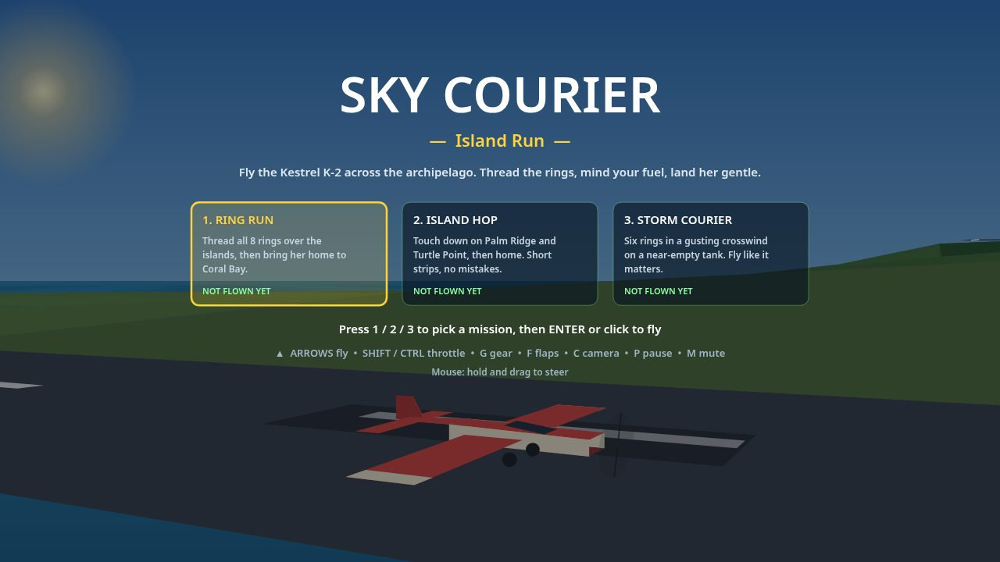
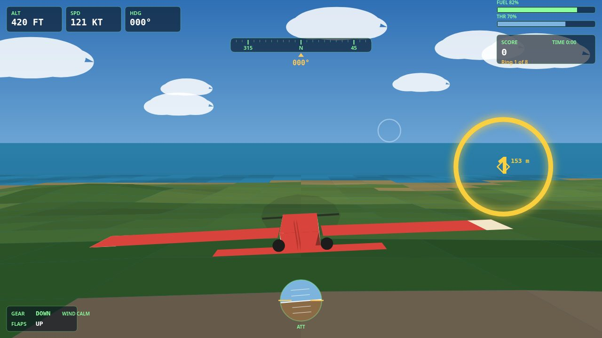
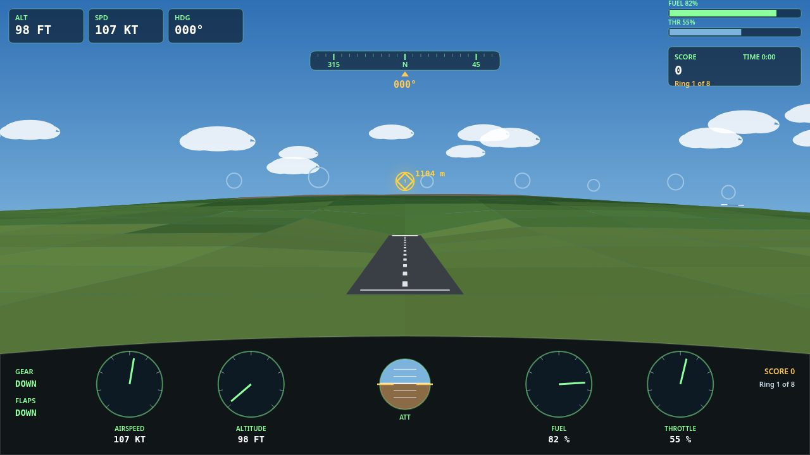
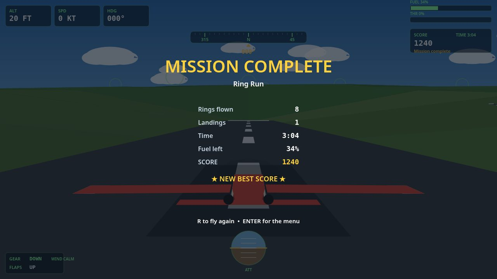

[](https://make.fun/bounty/best-flight-game-20261126-0057)
[](https://make.fun/bounty/best-flight-game-20261126-0057)
[](https://make.fun/bounty/best-flight-game-20261126-0057)

# Sky Courier — Island Run

Fly the Kestrel K-2 bush plane across a tropical archipelago. Thread the rings, mind your fuel, land her gentle. Built by an AI agent for make.fun's "Make the best flight game" bounty ($500 in USDC).

## Play

```sh
node serve.ts
```

Then open http://localhost:8080 in desktop Chrome. No build step, no network: the game is vanilla JavaScript and Canvas 2D, and every file it needs ships under `game/`.

## Screenshots

Real renders of the game itself, in the order the judge sees them:






## Controls

- **↑ / ↓** — climb / descend (W / S work too)
- **← / →** — bank left / right (A / D work too)
- **Shift / Ctrl** — throttle up / down
- **G** — landing gear, **F** — flaps, **B** — brakes
- **C** — chase / cockpit camera, **P** — pause, **M** — mute, **R** — restart
- **1 / 2 / 3** — pick a mission on the title screen, **Enter** — fly
- Mouse: hold and drag to steer

## Missions

1. **Ring Run** — thread all 8 rings over the islands, then bring her home to Coral Bay. Each ring pays 100 points and 6 fuel.
2. **Island Hop** — touch down on Palm Ridge and Turtle Point, then home. Short strips, no mistakes.
3. **Storm Courier** — six rings in a gusting 8 m/s crosswind on a near-empty tank.

Landings are scored: soft, centred and slow pays best. A gear-up touchdown, a hard landing, a fast one, a stall into the sea or a hillside all end the flight. Fuel burns with throttle; run dry and the engine quits.

## What is in the box

- `game/` — the game. `index.html` opens it; `src/` holds one module per job: `config.js` (tuning), `random.js` (seeded RNG and noise), `terrain.js` (the archipelago heightmap and runways), `physics.js` (the flight model), `missions.js` (objectives and scoring), `render.js` (the software 3D renderer), `input.js`, `hud.js`, `audio.js` (WebAudio engine and wind), `main.js` (the loop and state machine), `shots.js` (deterministic screenshot poses).
- `test/` — unit tests for the flight model, terrain, missions and renderer (`node --test test/`).
- `screenshots/` — four renders of the game itself: title, chase view through a ring, cockpit on final, mission complete.
- `main.ts` — the make.fun hand-in program; `serve.ts` — the static server; `vendor/makefun-game.ts` — the kit's vendored module, unchanged.

## Referral

Play on make.fun with referral code `pgd6qh00`.

## License

MIT — see [LICENSE](LICENSE).
